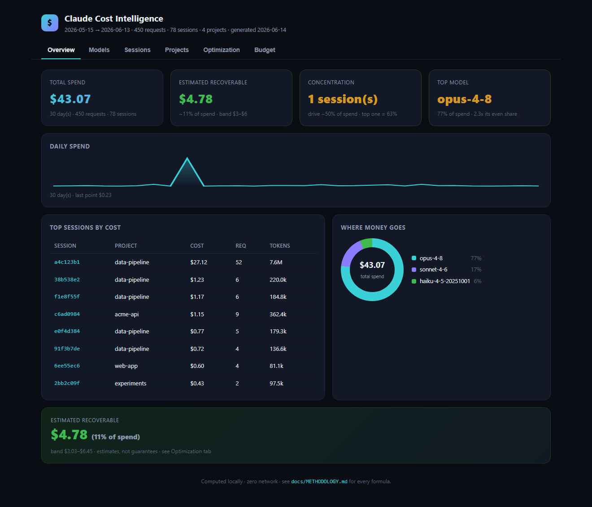
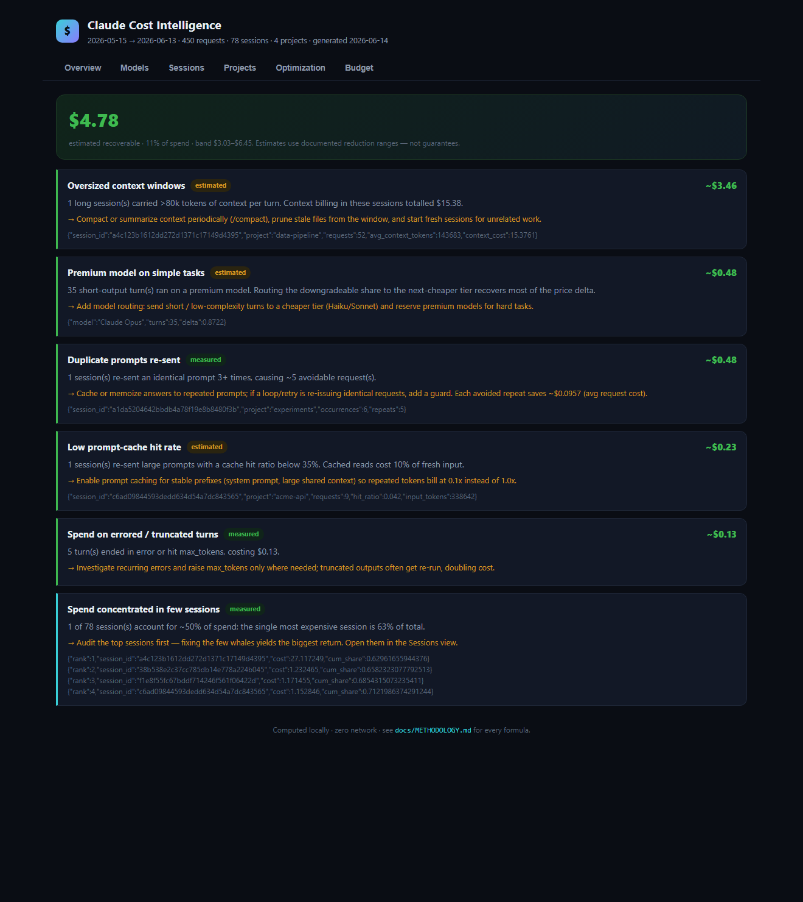
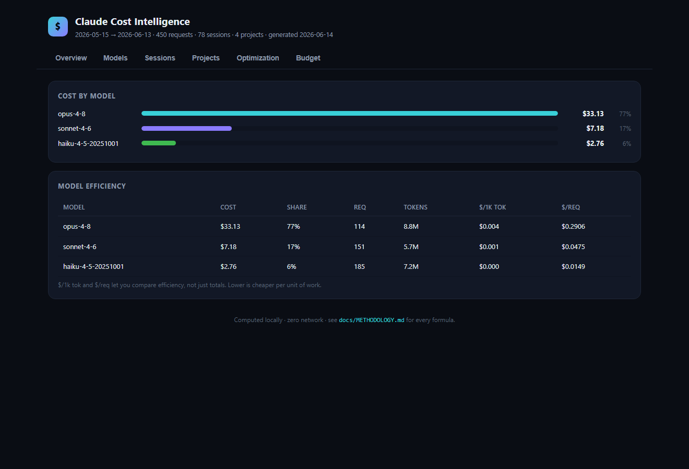
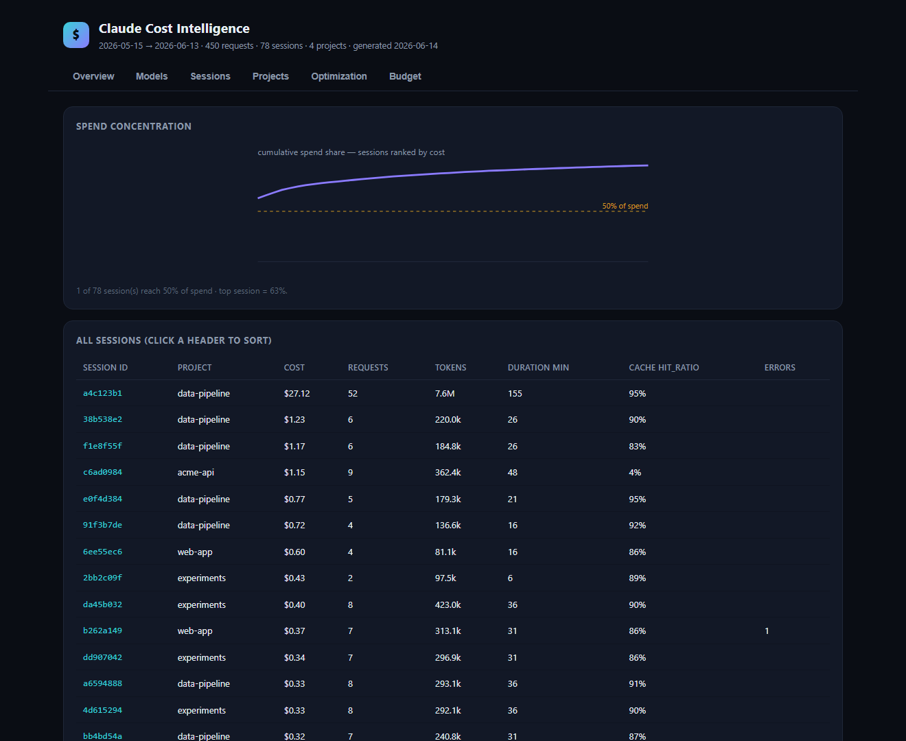
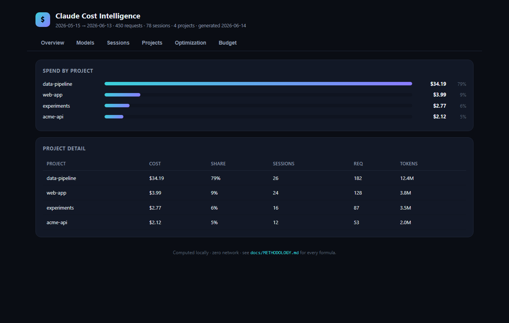
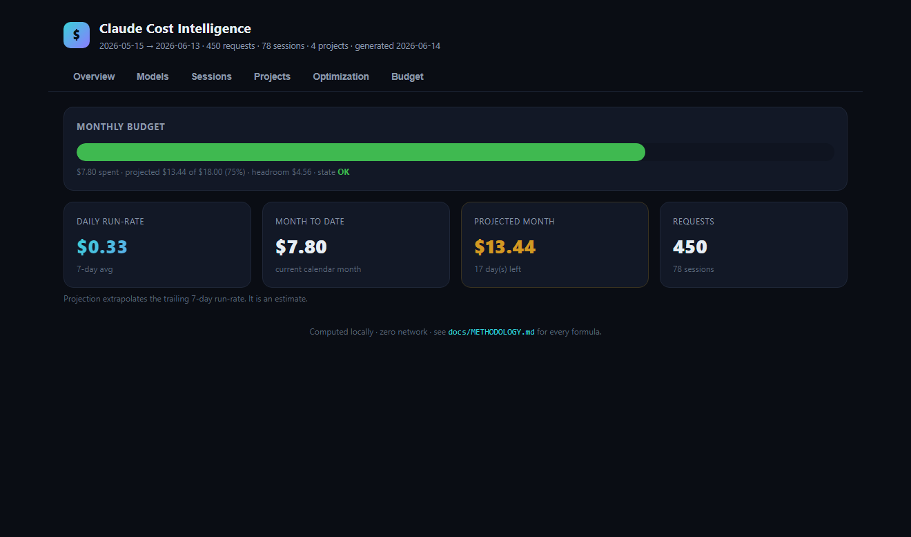

<div align="center">

# 💸 Claude Cost Intelligence

### See where your LLM money goes, why it goes there, and how to cut the waste.

A local-first **FinOps + spend-intelligence** layer for Claude Code and the Anthropic API.
Not another usage logger — it tells you *what to fix and what you'll save*.

[](https://github.com/ingridtoulotte/claude-cost-intelligence/actions/workflows/ci.yml)
[](LICENSE)


</div>

<p align="center">
  
</p>

---

## The pain

You're spending on LLM calls. You know *that* you're spending. You don't know **why**.

- Which **model** is eating the budget?
- Which **sessions** are quietly expensive?
- Where is the **waste** — duplicate calls, oversized context, premium models on trivial tasks?
- How much is **actually recoverable**, and what do you change to get it?

Provider dashboards show you a total *after the bill arrives*. Spreadsheets rot.
Token loggers dump numbers without telling you what they mean.

**Claude Cost Intelligence makes the problem visible — and actionable — before the bill.**

---

## The "holy crap" moment

Point it at your logs and within a second you get the headline:

```
  CLAUDE COST INTELLIGENCE        2026-05-15 → 2026-06-13  (30d)
  ────────────────────────────────────────────────────────────
  $43.07           Total spend         450 requests · 78 sessions
  $4.78            Recoverable         ~11% of spend · band $3–$6
  1 session(s)     Concentration       drive ~50% of spend · top = 63%
  opus-4-8         Top model           77% of spend · 2.3× its fair share
```

> One session was **63% of the entire month.**
> One model was **2.3× its even share.**
> ~**11% of spend is recoverable** — and every dollar is traced to a fix.

That's the emotional hook: *I need to see where my money is going.*

---

## What it does

| | |
|---|---|
| 📊 **Tracks** | spend by model, project, session, day; tokens, cache usage, requests |
| 🔍 **Finds waste** | duplicate prompts, oversized context, premium-model overuse, low cache hit, errored turns |
| 💡 **Estimates savings** | a dollar band per finding, with documented methodology and confidence labels |
| 🎯 **Concentrates attention** | Pareto: the *few* sessions that drive *most* of the cost |
| 📈 **Projects + budgets** | run-rate forecast, monthly budget gauge, warn/over states |
| 🖥️ **Visual dashboard** | one self-contained HTML file — no server, no CDN, no network |

---

## The six views

<table>
<tr>
<td width="50%"><b>Overview</b><br></td>
<td width="50%"><b>Optimization</b> — every finding, its cost, the fix, the saving<br></td>
</tr>
<tr>
<td width="50%"><b>Models</b> — cost & efficiency ($/1k tok, $/req)<br></td>
<td width="50%"><b>Sessions</b> — Pareto curve + sortable session table<br></td>
</tr>
<tr>
<td width="50%"><b>Projects</b> — spend & hotspots by repo<br></td>
<td width="50%"><b>Budget</b> — run-rate, projection, budget gauge<br></td>
</tr>
</table>

---

## Quick start

```bash
# 1. install (zero runtime dependencies)
pip install -e .

# 2. see it instantly on synthetic data (no real logs needed)
cci sample                                   # writes examples/sample-usage.jsonl
cci dashboard --path examples/sample-usage.jsonl --open

# 3. run it on YOUR Claude Code usage
cci                                          # terminal report (~/.claude/projects)
cci dashboard --open                         # full HTML dashboard
```

That's it. No account, no API key, no server. Everything is computed locally.

### Common commands

```bash
cci report                       # terminal cost-intelligence report (default)
cci dashboard --out spend.html   # generate the HTML dashboard
cci budget --set 200             # check projected spend against a $200 budget
cci json --compact               # machine-readable report (pipe into anything)
cci report --since 2026-06-01 --project my-api    # filter by date / project / model
cci selftest                     # run the built-in test battery (no pytest needed)
```

---

## Actionable, not just informational

Every finding tells you **what happened, why it matters, the cost, and the fix**:

> 💸 **Oversized context windows** `estimated`  →  **~$3.46**
> 1 long session carried >80k tokens of context per turn (context billing: $15.38).
> → *Compact/summarize context periodically, prune stale files, start fresh sessions.*

> 💸 **Premium model on simple tasks** `estimated`  →  **~$0.48**
> 35 short-output turns ran on a premium model.
> → *Route short/low-complexity turns to a cheaper tier; reserve premium for hard tasks.*

> 💸 **Duplicate prompts re-sent** `measured`  →  **~$0.48**
> A session re-sent an identical prompt 6× (5 avoidable requests).
> → *Cache/memoize repeated answers; guard retry loops.*

---

## Before / after

| | Blind spending | With Claude Cost Intelligence |
|---|---|---|
| **When you learn** | after the invoice | before the invoice |
| **Granularity** | one monthly total | model · project · session · day · prompt |
| **Waste** | invisible | named, quantified, ranked |
| **Savings** | "spend less, somehow" | a dollar band + the exact change to make |
| **Trust** | black box | every formula published in [METHODOLOGY.md](docs/METHODOLOGY.md) |
| **Privacy** | data leaves your machine | 100% local, zero network |

---

## How it compares

| | Provider dashboard | Spreadsheet | Token logger | Generic APM | **CCI** |
|---|:---:|:---:|:---:|:---:|:---:|
| Local-first / private | ❌ | ✅ | ⚠️ | ❌ | ✅ |
| Per-session / per-prompt cost | ❌ | ❌ | ⚠️ | ⚠️ | ✅ |
| Cache-aware exact pricing | ⚠️ | ❌ | ⚠️ | ❌ | ✅ |
| **Waste detection** | ❌ | ❌ | ❌ | ⚠️ | ✅ |
| **Savings estimates** | ❌ | ❌ | ❌ | ❌ | ✅ |
| Actionable recommendations | ❌ | ❌ | ❌ | ⚠️ | ✅ |
| Zero setup / zero deps | ⚠️ | ✅ | ⚠️ | ❌ | ✅ |

The difference in one line: **cost *intelligence*, not cost *logging*.**

---

## Trust — what's exact vs estimated

CCI never fakes a number and never implies precision it doesn't have.

- **Exact:** every cost (cache-tier-aware list pricing), all totals, by-model/project/day, sessions, Pareto concentration.
- **Estimated (labelled, shown as a band):** savings per finding and the month projection.
- **Flagged:** any model with no price is costed at `$0` *and* the report warns you spend is understated.

Every formula and threshold is published in **[docs/METHODOLOGY.md](docs/METHODOLOGY.md)**.
Don't trust the dashboard? Run `cci json` and check the raw math yourself.

---

## How it works

```
~/.claude/projects/**.jsonl
        │  ingest (stream, skip-malformed)
        ▼
   normalize ──► cost (cci/pricing.py, exact)
        │
        ├─► analytics  (totals · by model/project/day · sessions · Pareto · projection)
        └─► waste      (duplicates · context bloat · model overuse · cache · errors)
                 │
                 ▼
        insights ──► report (terminal) · dashboard (HTML) · json
```

Pure Python **standard library**. No pandas, no chart library, no telemetry.
Cross-platform (Linux/macOS/Windows), Python 3.9–3.12.

---

## FAQ

**Does this work locally?**
Yes — 100%. It reads files on your disk and writes a local HTML file. Nothing is sent anywhere; there is no network code.

**Can I compare models?**
Yes. The Models view ranks cost, share, and efficiency ($/1k tokens, $/request), and the optimizer flags premium models used on simple tasks.

**Are the savings estimates exact?**
No, and they don't claim to be. Costs are exact; *savings* are estimates shown as a low–high band with a documented method and a `measured`/`estimated` confidence label.

**Can I use it for multiple projects?**
Yes — it aggregates across every project under `~/.claude/projects`, with a Projects view and `--project` filtering.

**Does it support the raw Anthropic API, not just Claude Code?**
The pricing/cost engine is provider-generic. The ingestor reads Claude Code JSONL today; any source normalized to the same token fields flows through unchanged (a documented extension point).

**My model isn't priced / I have enterprise pricing.**
Add prices via `--pricing rates.json` or a `cci.config.json`. Unpriced models are flagged, never silently zeroed.

---

## Roadmap

First release stays focused: **make spend visible and waste actionable.** Next:

- [ ] Anomaly detection (spend spikes vs baseline)
- [ ] Team dashboards & shared budgets
- [ ] Scheduled reports (daily/weekly digest)
- [ ] Multi-provider ingestors (OpenAI, Gemini, Mistral)
- [ ] Policy rules ("alert if any session > $X", "block Opus for < N output tokens")
- [ ] Exportable insight snapshots (PNG/PDF)

---

## Contributing

Issues and PRs welcome — see [CONTRIBUTING.md](CONTRIBUTING.md). Run `cci selftest` and `pytest -q` before pushing.

## License

[MIT](LICENSE) © 2026 Ingrid Toulotte
